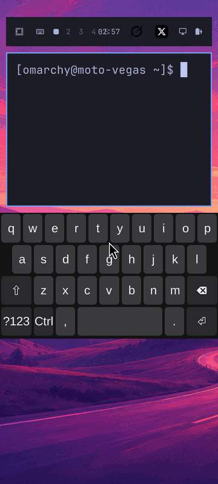
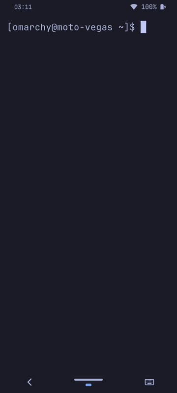
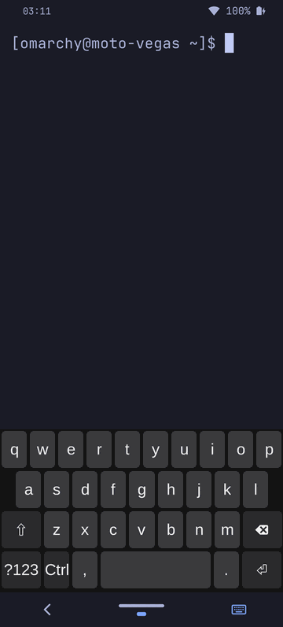
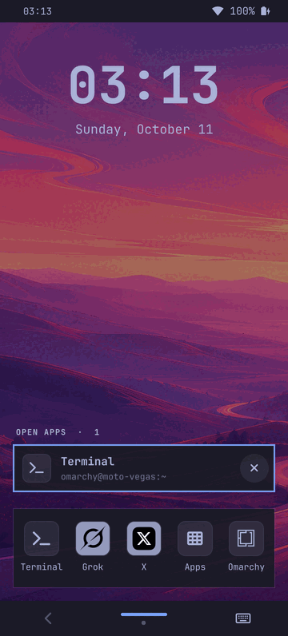
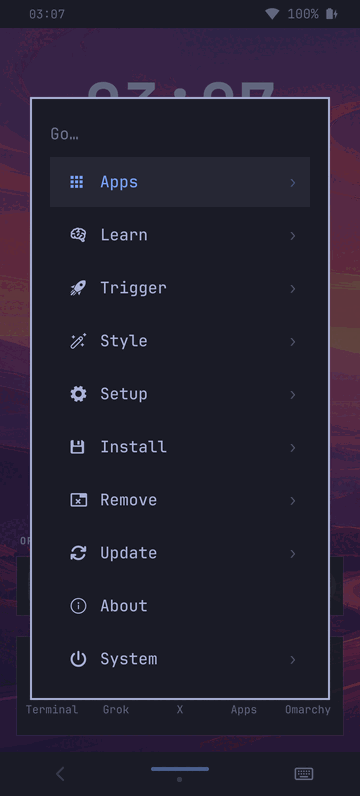
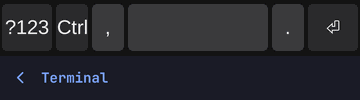
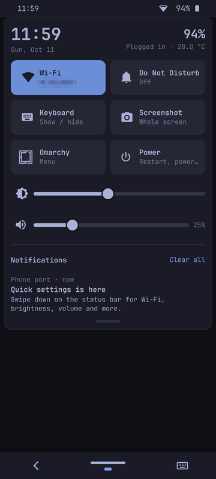

# Omarchy mobile: phone UI (2026-10-11)

The phone ran the desktop Omarchy layout squeezed onto a 360 × 796 pt
screen (1080 × 2388 px at UI scale 3): one cramped top bar holding the menu,
keyboard toggle, five workspace numbers, clock, two app icons, display and
power widgets (the clock overlapped workspace 4), and app windows inset by
gaps, a wallpaper frame and a blue border. There was no touch way to go home,
close an app or see what was running, other than tiny workspace numbers.

This note records the redesign: why it looks the way it does, how to use and
configure it, and what is left. It is installed and live on the phone.

| Before | App | App + keyboard | Home | Omarchy menu |
|---|---|---|---|---|
|  |  |  |  |  |

Swipe preview while dragging right on the nav bar: 

## First principles

What a phone shell has to do, regardless of Android or iOS:

1. **Show the app, nothing else.** The screen is small; every point of
   chrome is a point of content lost. Chrome may only exist where it does a
   job that can't be done elsewhere.
2. **Let one thumb get anywhere in one move.** Holding a 6.8" phone in one
   hand, the thumb reaches the bottom third comfortably and the top badly.
   Things you *do* belong at the bottom; things you only *look at* can sit at
   the top.
3. **Always have a way out.** Whatever app is on screen, there must be an
   always-present, always-identical control to go back, go home and switch.
4. **Show state you can't otherwise know**: time, battery, connectivity,
   which apps are running.
5. **Be cheap.** This phone renders the shell with Qt's software renderer and
   composites on a weak Mali; anything that redraws continuously, blurs, or
   blends large translucent layers costs frames in the app you're using.

And what is specific to this system:

- Hyprland already *is* the app model: the `workspace = "empty"` rule puts
  each app full-screen on its own workspace. An app = a workspace; going home
  = going to an empty workspace. No new window-management concept is needed.
- Hyprland's own gestures are touchpad-only; there is no touchscreen gesture
  support (no hyprgrass) in this build. Any edge gesture must come from a
  surface that owns the touch, which means a layer-shell strip.
- A layer-shell surface that overlays an app steals every touch in its area
  (X's bottom tab bar lives in the bottom 50 pt). A gesture area has to be
  **reserved** (exclusive zone), not floated over content.

## The design

```
 ┌──────────────────────────────┐
 │ 14:05        (o)      ▂▄▆ 96%│  status bar, 28 pt, under the camera hole
 ├──────────────────────────────┤
 │                              │
 │                              │
 │        app, edge to edge     │  no gaps, border, rounding or transparency
 │                              │
 │                              │
 ├──────────────────────────────┤
 │   ‹          ━━━         ⌨   │  navigation bar, 44 pt
 │             ▬ • •            │  (one dot per open app; dash = current)
 └──────────────────────────────┘
```

### Status bar (top, 28 pt)

Time on the left, SD badge (only when booted from the microSD copy), Wi-Fi
strength and battery percentage on the right. The centre is left empty on
purpose: that is where the camera punch-hole is, and the bar's 28 pt height
is exactly the band the camera already makes unusable for content (the old
bar started *below* it, at 28 pt, and was 48 pt tall: 76 pt of chrome
became 28). It is the existing `vegas.bar` (Omarchy's bar, cloned) with a
slimmer layout, so Omarchy's own popups still work: tap the battery for the
power panel, tap the clock for the calendar.

Nothing interactive that you need often lives up here — it is the hardest
place to reach. The menu, keyboard toggle, workspace numbers and app icons
moved to the bottom.

### Navigation bar (bottom, 44 pt)

Three targets, each a third of the width (120 × 44 pt):

| Tap | Does |
|---|---|
| ‹ (left) | **Back**: sends the app's own back key: Alt+Left in Chrome web apps (browser history), Escape elsewhere (terminal, dialogs). |
| handle (centre) | **Home** |
| ⌨ (right) | Show/hide the on-screen keyboard (lit while it is up) |

Gestures anywhere on the strip:

| Gesture | Does |
|---|---|
| drag left / right ≥ 40 pt | next / previous open app; while dragging the bar shows `X ›` / `‹ Grok`, and highlights once releasing will switch |
| drag up ≥ 18 pt | Home |
| long-press centre | Omarchy menu |

Under the home handle there is one dot per open app, the current one a dash.
It answers "what's running?" at all times and shows where a swipe lands,
without any extra space.

### Home screen

Home is an empty workspace, and the home screen is drawn on Hyprland's
*bottom* layer there. It appears whenever no app is on the focused workspace
— after pressing Home, and automatically after closing the last app — and is
unmapped otherwise, so it costs nothing while an app is open.

- Top (glance zone): large clock and date.
- Lower half (thumb zone): **Open apps** as large rows in the same order as
  the swipe/dots, each with icon, name and window title. Tap to return, tap
  × or swipe the row sideways to close.
- Bottom: **pinned apps** (Terminal, Grok, X, Apps, Omarchy). Tap opens the
  app or switches to it if it is already open; long-press opens another
  instance. *Apps* opens Omarchy's app launcher; *Omarchy* opens the Omarchy
  menu.

Home doubles as the app switcher: with a handful of apps on a phone, a
separate recents screen and home screen show the same thing twice.

### Content edge to edge

Hyprland gaps, borders and rounding are zero on this device, and Omarchy's
default 98.5 %/96 % window opacity is overridden to opaque (it only blended
the wallpaper into every app frame). The bars and keyboard are exclusive
zones, so apps resize around them; the keyboard now sits directly on top of
the navigation bar instead of floating 16 pt above the bottom edge (the nav
bar is the bottom safe area now).

## What came from Android / iOS, and what didn't

Taken:

- A persistent bottom navigation affordance with a home handle (iOS home
  indicator, Android gesture pill) and horizontal swipe on it to flip
  between apps (both).
- Back as a system button (Android). iOS has none, and relies on every app
  drawing its own; Chrome `--app` windows have no back button at all, so the
  system has to provide it.
- A keyboard button in the nav bar while typing (Android).
- Status bar layout around a centre punch-hole (both).
- Swipe-to-dismiss on app cards (both).

Done differently:

- **Buttons *and* gestures on the same strip.** Pure gesture nav (iOS, modern
  Android) needs a sliver of screen but is undiscoverable and relies on
  fluid, animated tracking that this GPU/software-rendered shell can't afford
  without hurting the app underneath. Pure 3-button nav is discoverable but
  needs a dedicated recents button and screen. Here every action is a visible
  tap target, and the gestures are shortcuts for people who know them.
- **Home *is* the switcher.** No separate recents screen with live
  thumbnails (expensive screen capture on this hardware; and with 2–5 apps a
  list with icons and titles is faster to read than shrunken screenshots).
- **The app order is spatial and stable** (workspace order), not
  most-recently-used. Both phones reorder recents as you use them, which
  makes "the app two swipes to the left" a moving target. Here the dots and
  the swipe order are the same fixed row.
- **Home is a place, not an overlay.** It is literally the empty workspace
  Hyprland already has, so all of Hyprland's own keyboard bindings and
  workspace logic keep working, and nothing has to be shown, hidden or
  animated over a running app.
- **No animations.** Hyprland animations stay off and nothing in the shell
  animates. Feedback is immediate state change (pressed highlight, swipe
  preview label). On this hardware that feels faster than a 300 ms
  transition would.

## Verified on the phone

All with real touch events injected into the Ilitek evdev node (kernel →
libinput → Hyprland → Quickshell), screenshots after each step:

- Nav bar taps: Back, Home, keyboard show/hide (app resizes 360×724 ↔
  360×517). Back sends Escape to Foot (read back as byte 033) and goes back
  a page in a Chrome `--app` window after a real link tap.
- Swipe left/right: steps through apps in both directions, 6/6 repeated
  swipes; a swipe past the last app shows "No more apps" and does nothing.
  Swipe up: Home.
- Long-press centre: Omarchy menu; Back closes it, and closes bar popups.
- Home: tap a row to return; × closes; swiping a row sideways closes;
  pinned tap opens or focuses, long-press opens a new instance; Apps tile
  opens Omarchy's app launcher. Five open apps fit without scrolling.
- Status bar: battery popup opens below it; a downward swipe on it no longer
  moves the bar (see below).
- Idle cost over 10 s: Quickshell 0 ticks in an app, 1 tick on Home;
  Hyprland 0. Tap → home layer mapped ≈ 60 ms after finger-up, swipe →
  workspace switched ≈ 100 ms after finger-up (the measured 115–145 /
  215–240 ms include ~60 ms of Python start-up in the injector and the
  gesture itself).
- `hyprctl configerrors` empty after reload; shell restarts load all plugins
  without QML errors.

### Problems found and fixed along the way

- **Keyboard floating mid-screen after boot.** wvkbd started visible with
  `--auto` raced its first show/hide; Hyprland then kept a destroyed,
  never-mapped `wvkbd` layer (`a: 0` in `hyprctl layers`) that still
  reserved 207 pt, so the real keyboard sat above it with wallpaper below.
  Reproduced with plain `wvkbd-mobintl … --auto`; not with `--hidden --auto`.
  `vegas-keyboard` now starts it hidden (`--auto` shows it on text focus).
- **Keyboard stuck on Home.** wvkbd only hides on an input-method
  deactivate, which Hyprland doesn't send when focus moves to an empty
  workspace or when a focused overlay (menu search) closes. vegas.mobile
  re-checks 250 ms after reaching Home or any layer closing and hides it.
- **Lost touch after long-press launch.** Launching while the finger was
  still down unmapped the home surface mid-touch; Qt kept that touch point
  pressed and swallowed the next touch. Long-press actions now run on
  release, and no action changes surfaces while a finger is down.
- **Swipe down moved the status bar.** Omarchy's bar treats a drag on empty
  bar space as "move the bar to another edge" (and drag on a widget as
  reorder, double-tap as transparency). On a touchscreen these fire on
  ordinary swipes; a swipe down persisted `position: bottom`. The phone bar
  fork now locks them (`bar.phoneLockLayout`, default true).

## Performance

- Nav bar: a 1080 × 132 px opaque surface, repainted only on touch and when
  the app list changes. Home: mapped only on an empty workspace. Status bar:
  unchanged widget code, smaller surface than before.
- Wi-Fi widget reads `/proc/net/wireless` in-process every 20 s (no process
  spawn, no NetworkManager — this phone uses wpa_supplicant, so Omarchy's
  network widget would show nothing).
- Everything else is driven by Hyprland IPC events through Quickshell's
  `Hyprland` singleton; no polling.
- Opaque windows remove a full-screen blend per app frame.

## Configuration

`~/.config/omarchy/shell.json`:

```jsonc
"bar": {
  "id": "vegas.bar",
  "phoneSafeTop": 0,       // bar starts at the top edge (covers the camera band)
  "phoneBarHeight": 28,
  "phoneSideInset": 12,    // clears the rounded top corners
  "centerAnchor": "",
  "layout": {
    "left":   [{ "id": "omarchy.clock", "format": "HH:mm" }],
    "center": [],
    "right":  [{ "id": "vegas.bootsource" }, { "id": "vegas.wifi" },
               { "id": "omarchy.power", "showPercentage": true }]
  }
},
"plugins": [{
  "id": "vegas.mobile",
  "navHeight": 44,         // 32–96
  "home": true,            // false: no home screen (Home just shows wallpaper)
  "gestures": true,        // false: taps only
  "pinned": [              // home screen row; up to 5 per row
    { "name": "Grok", "icon": "~/.local/share/icons/hicolor/256x256/apps/grok.png",
      "exec": "/usr/local/bin/omarchy-launch-webapp https://grok.com",
      "match": "^chrome-grok\\.com" },          // regex on app id: focus if open
    { "name": "Terminal", "glyph": "", "exec": "foot", "match": "^foot$" },
    { "name": "Apps", "glyph": "", "action": "apps" },   // Omarchy launcher
    { "name": "Omarchy", "glyph": "", "font": "omarchy", "action": "menu" }
  ],
  "back": [                // optional: first matching rule wins
    { "match": "^(chrome|chromium)", "mods": "ALT", "key": "Left" },
    { "match": ".*", "mods": "", "key": "Escape" }
  ]
}]
```

`icon` takes an absolute or `~/` path or an icon-theme name; without one, a
`glyph` (Nerd Font / `font`) or the name's initial is drawn on a tile. Open
apps get their icon from a matching pinned entry, then the desktop entry
for their app id.

Scripting / hardware keys: `omarchy-shell phone act home|back|next|previous|close|keyboard|menu|state`
(`state` prints the app list as JSON; `"debug": true` in the plugin entry logs nav gestures)
(or `omarchy-shell shell summon vegas.mobile '{"action":"home"}'`).

To go back to the previous desktop-style bar, restore
`~/.config/omarchy/shell.json.before-ui` (and `looknfeel.lua.before-ui` for
gaps/borders), then restart the shell. The old `vegas.apps`, `vegas.keyboard`
widgets and Omarchy's workspace widget are still installed and can be put
back in the bar layout.

## Quick settings (added 2026-10-11, late morning)

 (Wi-Fi name pixelated)

Plugin `vegas.quick` (`plugins/vegas-quick/Quick.qml`, enabled by its `plugins[]` entry in shell.json):

- **Open:** swipe down on the status bar (anywhere: the empty bar is vegas.bar's `CenterGestureArea`, which acts
  on release when the layout is phone-locked; a `DragHandler` on the bar takes over swipes that start on a
  widget, so taps still open the clock/battery popups), or `qs ipc call quick toggle`.
- **Close:** tap outside the card, swipe the card up, or the nav bar's Back/Home (`vegas.quick` is first in
  vegas.mobile's dismissable list).
- The window keeps out of the bars' and keyboard's exclusive zones (`ExclusionMode.Normal`), so the status
  bar and nav bar stay usable. It puts the on-screen keyboard away when it opens (wvkbd SIGUSR1) and brings it
  back for a Wi-Fi password (SIGUSR2).
- **Header:** time/date, battery %, Charging / Plugged in / Full, battery temperature (red at the 37 °C boost
  limit).
- **Tiles:**
  - Wi-Fi: tap for the network list, long-press for on/off
  - Do Not Disturb (Omarchy's notification service)
  - Keyboard
  - Screenshot (grim to ~/Pictures, closes the shade first)
  - Omarchy menu
  - Power (Omarchy's system menu)
- **Sliders:** brightness writes the backlight directly (group video; never below 1%). Volume uses `wpctl` on the
  default sink, and the icon toggles mute. Writes are throttled to one in flight while dragging.
- **Wi-Fi picker:** `vegas-wifi list [--scan]` (current/saved/dBm/secured/ssid, tab-separated) and
  `vegas-wifi join SSID`. The password goes over stdin, never on a command line. A saved network reconnects
  without one; a network that doesn't connect within 20 s is disabled again. `vegas-wifi on|off` =
  wpa_supplicant reconnect/disconnect (the radio stays powered).
- **Notifications:** the newest 5 history entries (app · age, summary, 2 lines of body) and Clear all.
- Tested with injected touches (`swipe.py` through the real touchscreen evdev node): open from the bar centre and
  from the battery icon; close by tapping outside, swiping up, and Back; Wi-Fi list; brightness 889 → 315 → 888;
  volume drag; DND on/off; a notification showing up. The battery tap still opens Omarchy's popup.
- Gotchas found:
  - Quickshell reload is off (`QS_DISABLE_FILE_WATCHER`), and the plugin index
    `$XDG_RUNTIME_DIR/omarchy-plugin-scan.txt` is built by `vegas-launch-shell`. A new plugin needs
    `vegas-launch-shell --index-only` + a shell restart. Relaunch through `vegas-launch-shell` (not
    `omarchy-restart-shell`), or the shell loses `QT_QUICK_BACKEND=software`.
  - A `DragHandler`'s `activeTranslation` is already 0 in `onActiveChanged(false)`: keep the last value from
    `onActiveTranslationChanged`.
  - The desktop runs on its own `dbus-run-session` bus (curated activation, `proot-session-bus.conf`), not the
    systemd user bus at `/run/user/1000/bus`. `notify-send` from outside the session must use the session's
    `DBUS_SESSION_BUS_ADDRESS` (see quickshell's environ). Moving to the user bus is phase 2 of the systemd
    migration.

## Power key (added 2026-10-11)

`vegas-power-key` (session daemon, autostart.lua) reads `mtk-pmic-keys` directly:

- **short press** (< 0.6 s): screen off/on (`hl.dsp.dpms`)
- **long press**: the power menu (Omarchy's system menu), switching the screen on first
- a key from the panel's `double-tap` gesture device wakes the screen (the key codes are not verified yet)

hyprland.lua unbinds Omarchy's `XF86PowerOff` (system menu on every press) and turns off
`key_press_enables_dpms`/`mouse_move_enables_dpms`, so volume keys or touches can't light the panel in a pocket.
DPMS through mediatek-drm works without errors. The ILITEK TDDI touch controller re-initializes with the panel,
so touch is off while the screen is.

The system menu's Suspend (`systemctl suspend`: refused by the polkit rule, untested) and Hibernate (no swap, no
resume path) entries are hidden by `~/.config/omarchy/extensions/omarchy-menu.jsonc`. That file overrides them as
links to an empty submenu, because the menu skips `when:` guards while `OMARCHY_PROOT=1` (unless
`OMARCHY_UNLIMITED_PROCS=1`, which would also start update checks, clipboard watchers and weather fetches).
`omarchy-hibernation-available` in /usr/local/bin answers no.

Not yet: a lock screen. (Suspend and the screen timeout: notes/suspend-20261011.md.)

**Double-tap to wake.** The touch driver (`ilitek_v3_mmi`, built with ILI_DOUBLE_TAP_CTRL) ignores the
`dt-gesture` sensor's `enable`. Gesture mode is armed through `/sys/devices/virtual/touchscreen/primary/gesture`,
which reads `06` at boot but only takes effect when written: `32` (0x20, single tap off; pocket touches) then
`49` (0x31, double tap on). The log then shows `should_enable_gesture=1`, and a screen-off takes the gesture-suspend
path instead of `TP_DEEP_SLEEP`. `libexec/vegas/touch-gestures` does this before the desktop starts (opt out with
`/var/lib/vegas/no-double-tap`); a double tap arrives as a key on the `double-tap` input device, which vegas-power-key
turns into screen-on. **Still to test by hand:** a double tap with the screen off, and while asleep (whether the
touch IRQ is a wake source).

## Patches to Omarchy's own files

`/usr/share/omarchy` is the pinned omarchy-android bundle (no package owns it). Phone fixes to it live as patches
in `/usr/local/share/vegas/omarchy-patches/*.patch`. `/usr/local/libexec/vegas/omarchy-patches` applies them
before the desktop starts (desktop-pre, native-init). It is idempotent, and logs a patch that no longer applies.

- `10-notification-width.patch`: notification toasts were a fixed 380 pt, anchored top-right, on a 360 pt screen,
  so the left edge was cut off. The card is now capped at the screen width minus 8 pt margins, with an 8 pt right
  margin.

- `20-calendar-width.patch`: the clock's calendar grid was 7 × 52 pt cells + a 32 pt week column + a 14 pt gutter
  = 410 pt, so Saturday, Sunday and the next-month arrow were cut off. Cells now shrink to fit (38 pt on the phone),
  and the 48/52 px hero date scales by min(1, (screen − 60)/440).

Checked and fine as they are: the app launcher (Omarchy menu "apps"), the system menu, the battery popout and the
Bluetooth device list.

The volume OSD (`omarchy-osd`, from the volume keys) already fits: a centered card above the nav bar.

## What's left

- **Notification indicator** in the status bar (none yet; the shade lists history).
- **Wi-Fi:** hidden networks, forgetting a network, and real radio off (needs root) are not in the shade.
- **Fullscreen apps** (video) cover the bars; leave fullscreen with the
  app's own control. A thin edge-swipe strip could be added if needed.
- **Live tracking/animation** of the swipe (sliding the app with the
  finger) was deliberately left out for cost; worth revisiting only if
  Hyprland's workspace animation can run on the Mali without hurting Chrome.
- **Keyboard auto-show** when returning to a terminal is up to wvkbd's
  `--auto` (input-method activate); sometimes it needs the ⌨ button. A
  real fix is in wvkbd (apply activate/deactivate on `done`) or Hyprland.
- **Rounded corners/camera** clearances (12 pt spacers, empty centre) were
  chosen from the earlier fit check and screenshots, not measured on the
  glass; the webcam rig was not connected during this session.
- `scripts/prepare-vegas-phone-bar.py` no longer regenerates the bar fork
  exactly (it predates the phoneScale and phoneLockLayout changes); the
  committed `vegas-bar/Bar.qml` is the source of truth. The older
  `prepare-vegas-phone-update.py` archive list doesn't include the new
  plugins either.
- Landscape is not handled (no rotation on this port yet).

## Rollback

On the phone, each replaced file has a `*.before-ui` copy:
`~/.config/omarchy/shell.json`, `~/.config/hypr/looknfeel.lua`,
`~/.config/hypr/hyprland.lua` (comment only), `/usr/local/bin/vegas-keyboard`.
Copy them back, `hyprctl reload`, and restart the shell. The new plugin
directories (`vegas-mobile`, `vegas-wifi`) are inert when not referenced in
shell.json. The `vegas-bar` lock is a plain addition (`Bar.qml.before-ui`
backup); set `"phoneLockLayout": false` to get the desktop gestures back.

## Files

- `port/vegas/root/home/omarchy/.config/omarchy/plugins/vegas-mobile/` —
  `Mobile.qml` (state + actions), `NavBar.qml`, `Home.qml`, `AppIcon.qml`.
- `port/vegas/root/home/omarchy/.config/omarchy/plugins/vegas-wifi/` — Wi-Fi bar widget.
- `port/vegas/root/home/omarchy/.config/omarchy/shell.json` — layout above.
- `port/vegas/root/home/omarchy/.config/hypr/looknfeel.lua` — zero gaps/borders/rounding, opaque windows.
- `port/vegas/root/home/omarchy/.config/omarchy/plugins/vegas-bar/Bar.qml` — `phoneLockLayout`.
- `port/vegas/root/usr/local/bin/vegas-keyboard` — starts hidden; no bottom margin when the nav bar is enabled.
- `docs/ui/*.png` — screenshots (downscaled); full-size ones in `artifacts/ui-redesign/` (not in Git).
